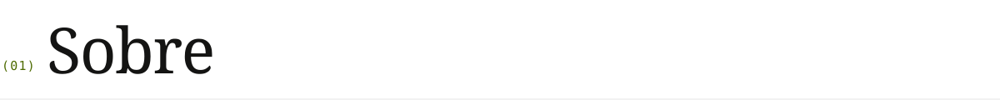
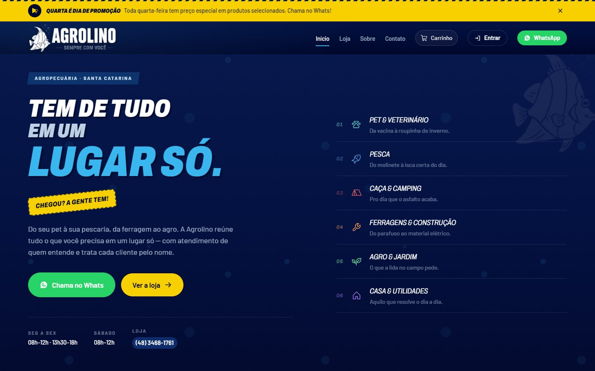
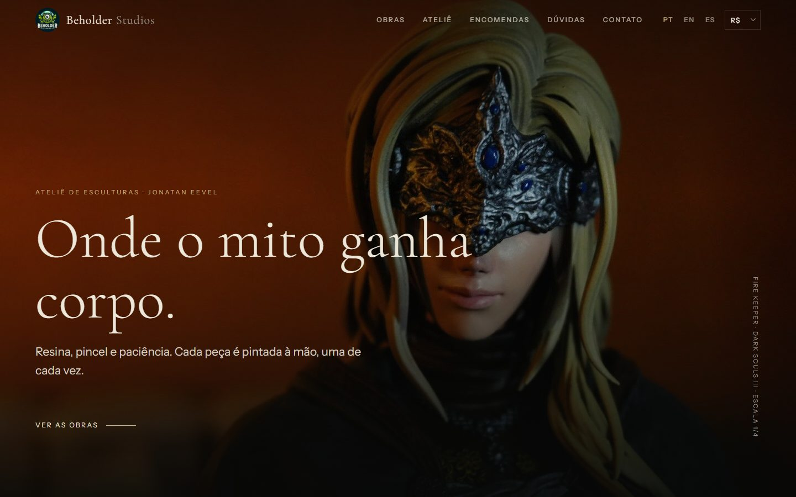
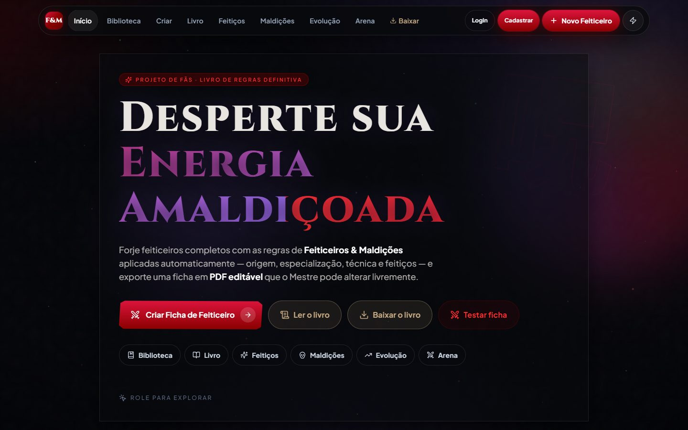
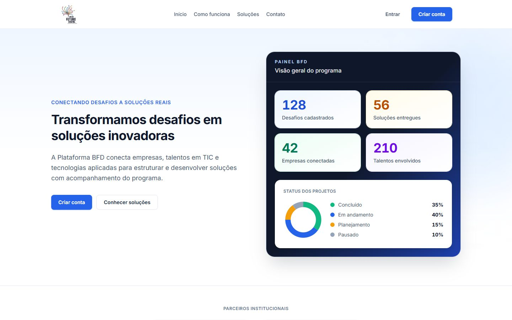
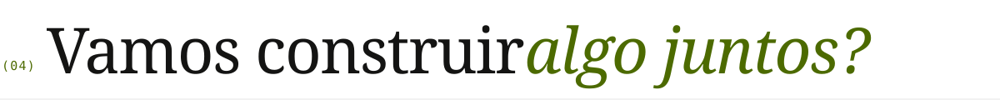

<a href="https://igordeaguiar.vercel.app">
  <picture>
    <source media="(prefers-color-scheme: dark)" srcset="assets/hero-dark.svg">
    
  </picture>
</a>

  
  
  
  

 

<picture>
  <source media="(prefers-color-scheme: dark)" srcset="assets/secao-sobre-dark.svg">
  
</picture>

Sou **dev full stack júnior**. Estudo Análise e Desenvolvimento de Sistemas no SENAC e fiz o curso de Desenvolvimento Web da UNESC. No back uso **Python com FastAPI e Postgres**; no front, **Next.js e React com TypeScript**.

Gosto de construir produto para negócio real: uma agropecuária que precisava vender online, padarias que perdem encomenda por falta de controle de horário, um ateliê que queria mostrar as peças sem cara de loja.

<table>
  <tr>
    <td valign="top"><code>LINGUAGENS</code>  
      
      
      
      
    </td>
    <td valign="top"><code>BACKEND</code>  
      
      
      
      
    </td>
  </tr>
  <tr>
    <td valign="top"><code>FRONTEND</code>  
      
      
      
      
    </td>
    <td valign="top"><code>DADOS E INFRA</code>  
      
      
      
      
    </td>
  </tr>
</table>

 

<picture>
  <source media="(prefers-color-scheme: dark)" srcset="assets/secao-experiencia-dark.svg">
  
</picture>

<table>
  <tr>
    <td width="26%" valign="top"><code>2026 · ~3 MESES</code></td>
    <td valign="top">
      <b>Tech Lead da squad</b> · <a href="https://teste-plataforma.vercel.app/">Plataforma de Projetos BFD</a> 
      Plataforma nacional de projetos tecnológicos do Bolsa Futuro Digital / Conecta e Capacita. Alinhei decisões técnicas, organizei entregas e orientei a squad de frontend, backend e DevOps. FastAPI + PostgreSQL/Supabase no back, React/Next.js no front.
    </td>
  </tr>
  <tr>
    <td valign="top"><code>FREELANCE</code></td>
    <td valign="top">
      <b>Desenvolvedor front-end</b> · <a href="https://studio-beholder.vercel.app">Beholder Studios</a> 
      Site-galeria para um ateliê de esculturas, com clima de museu. Três idiomas, conversão de moeda pela cotação do dia e painel com login (Supabase + RLS) para o artista publicar peças pelo celular.
    </td>
  </tr>
  <tr>
    <td valign="top"><code>EM DUPLA</code></td>
    <td valign="top">
      <b>Desenvolvedor full stack</b> · Agrolino e InvenTag 
      Dois produtos construídos com <a href="https://github.com/gabrieldagostivana">Gabriel D'Agostini Vana</a>: e-commerce com API própria em FastAPI e Postgres assíncrono, e SaaS de inventário RFID com autorização no banco (RLS).
    </td>
  </tr>
  <tr>
    <td valign="top"><code>FORMAÇÃO</code></td>
    <td valign="top">
      <b>Análise e Desenvolvimento de Sistemas</b> · SENAC Criciúma (2026–2029, em andamento) 
      <b>Desenvolvimento Web</b> · UNESC Criciúma (2025–2026)
    </td>
  </tr>
</table>

 

<picture>
  <source media="(prefers-color-scheme: dark)" srcset="assets/secao-projetos-dark.svg">
  
</picture>

<table>
  <tr>
    <td width="50%" valign="top">
      
       <code>01 · E-COMMERCE · CLIENTE REAL</code>
      <h3>Agrolino</h3>
      Loja online de uma agropecuária de Balneário Rincão/SC: vitrine, busca, área do cliente e painel admin. O carrinho monta o pedido pronto no WhatsApp.
        Next.js · TypeScript · FastAPI · PostgreSQL
       <a href="https://agrolino.vercel.app"><b>Ver online ↗</b></a> · <a href="https://github.com/IG1816/agrolino">Código</a> · <a href="https://github.com/IG1816/agrolino-api">API</a>
    </td>
    <td width="50%" valign="top">
      
       <code>02 · GALERIA DE ARTE · FREELANCE</code>
      <h3>Beholder Studios</h3>
      Site de um ateliê de esculturas inspirado em galerias como a Wētā Workshop: foto em tela cheia, serifada elegante e nada de cara de loja.
        JavaScript · Supabase · i18n · Vercel
       <a href="https://studio-beholder.vercel.app"><b>Ver online ↗</b></a>
    </td>
  </tr>
  <tr>
    <td width="50%" valign="top">
      
       <code>03 · WEB APP · TEMPO REAL</code>
      <h3>Feiticeiros &amp; Maldições</h3>
      Mesa online de RPG baseada em Jujutsu Kaisen: fichas, compêndio, combate tático em grid, galeria 3D e multiplayer por WebSocket.
        JavaScript · Node.js · WebSocket · three.js
       <a href="https://feiticeiros-e-maldicoes.vercel.app"><b>Ver online ↗</b></a> · <a href="https://github.com/IG1816/feiticeiros-e-maldicoes">Código</a>
    </td>
    <td width="50%" valign="top">
      
       <code>04 · PLATAFORMA · SQUAD</code>
      <h3>Plataforma de Projetos BFD</h3>
      Conecta empresas com desafios a talentos em TIC, no programa Bolsa Futuro Digital. Atuo como tech lead da squad que a desenvolve.
        FastAPI · Next.js · Supabase · Trabalho em equipe
       <a href="https://teste-plataforma.vercel.app/"><b>Ver online ↗</b></a>
    </td>
  </tr>
</table>

**Outros projetos**

| | Projeto | Stack |
|---|---|---|
| `→` | [**FornoSlot**](https://github.com/IG1816/fornoslot) · SaaS de agendamento de retirada para padarias. Reserva por RPC com lock no Postgres: dois clientes nunca pegam o último horário. | Next.js · Supabase · RLS · Zod |
| `→` | [**InvenTag**](https://github.com/IG1816/inventag) · SaaS de inventário e rastreamento de ativos por RFID, com tratamento de divergências. | React · Vite · Supabase |
| `→` | [**LeadFinder**](https://github.com/IG1816/leadfinder) · CLI que acha negócios locais sem site e gera planilha de prospecção. | Python · Overpass API |
| `→` | [**Códice Amaldiçoado**](https://github.com/IG1816/codice-amaldicoado) · Skill de IA para o Claude sobre um RPG de mesa, com simulação de duelos em Python. | Python · LLM · Claude |

 

<picture>
  <source media="(prefers-color-scheme: dark)" srcset="assets/secao-contato-dark.svg">
  
</picture>

Estou aberto a vagas de desenvolvimento, estágio e projetos freelance: presencial ou híbrido em Içara, Criciúma e região, ou remoto de qualquer lugar. Respondo rápido.

  
  
  

